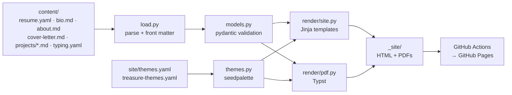

# kyut0.github.io

[](https://github.com/kyut0/kyut0.github.io/actions/workflows/ci.yml)

My portfolio site, built as a small data pipeline. Resume and project content live as
structured YAML/Markdown, are validated against typed schemas, rendered to static HTML
and PDFs, and deployed to GitHub Pages on every push to `main`.

**Live site:** https://katy-yut.com

## How it works



- **Extract:** `load.py` reads YAML and Markdown (with front matter) from `content/`, and
  `gitinfo.py` reads the newest commit's date and hash for the footer.
- **Validate:** `models.py` defines strict pydantic models. Unknown fields, bad dates,
  roles that end before they start, missing images, and a toolbox that disagrees with
  the timeline all fail the build.
- **Render:** `render/site.py` turns the validated `Site` into HTML using
  `site/templates/`. `render/timeline.py` reshapes the resume and projects into the
  Experience page's timeline, which tracks where each tool was first picked up.
  `render/pdf.py` compiles the same resume data with [Typst](https://typst.app/) into
  `resume.pdf`, `cover-letter.pdf`, and `cover-letter-and-resume.pdf`, so the site and
  PDFs can't drift apart.
- **Theme:** `themes.py` loads the color themes with
  [seedpalette](https://github.com/kyut0/seedpalette), which derives each palette from a
  few seed colors and fixes any text color too faint to read. Every theme gets its own
  CSS and its own set of PDFs (the default theme's at the site root, the rest in
  `pdf/<theme>/`), and the Download menu serves the visitor's current theme.
- **Deploy:** `.github/workflows/ci.yml` lints, type-checks, tests, and builds every push
  and pull request; `deploy.yml` builds and publishes `_site/` to Pages from `main`. The
  footer says "built from `<commit>`", linked to that commit on GitHub.
- **Domain:** the site is served at `katy-yut.com`, set as the custom domain in the
  repo's Pages settings. Because Pages deploys from Actions, there's no `CNAME` file.
  DNS is at Cloudflare: apex A/AAAA records to GitHub Pages, `www` as a CNAME to
  `kyut0.github.io`, all DNS-only (not proxied), plus the domain's GitHub verification
  TXT record. `kyut0.github.io` and `www` redirect to the apex.

The build never goes online: anything fetched from elsewhere (the Monkeytype stats in
`content/typing.yaml`) is a committed snapshot, refreshed with its own command.

## Quickstart

Requires Python 3.13+ and [Poetry](https://python-poetry.org/) 2.x.

```bash
make install    # poetry install + pre-commit hooks
make serve      # build and serve at http://127.0.0.1:8000
```

| Command         | What it does                                              |
| --------------- | --------------------------------------------------------- |
| `make validate` | Validate content without writing anything                 |
| `make build`    | Fresh build of the site and PDFs into `_site/`            |
| `make serve`    | Build, then serve `_site/` locally                        |
| `make check`    | Lint, type-check, and test (same as CI)                   |
| `make themes`   | Check every color theme and write `_site/themes-preview.html` |
| `make typing`   | Refresh `content/typing.yaml` from Monkeytype             |
| `make format`   | Auto-fix lint issues and format                           |
| `make clean`    | Remove build output and tool caches                       |

## Repository layout

```
├── content/                  # the data: what the site says
│   ├── resume.yaml           # roles, education, publications, toolbox
│   ├── bio.md                # home page intro
│   ├── about.md              # About page; images go in about/
│   ├── cover-letter.md       # general letter; published as a PDF only
│   ├── typing.yaml           # Monkeytype snapshot (`make typing`)
│   └── projects/<slug>.md    # one file per project; images in projects/<slug>/
├── site/                     # the presentation: how it looks
│   ├── templates/            # Jinja templates
│   ├── typst/                # PDF resume + cover letter layouts
│   ├── themes.yaml           # color themes (ADR 0004)
│   ├── treasure-themes.yaml  # hidden themes, unlocked by the easter egg (ADR 0005)
│   └── static/               # CSS, JavaScript, fonts, icons, images
├── src/portfolio/            # the pipeline
│   ├── models.py             # schemas
│   ├── load.py               # read + validate
│   ├── themes.py             # load themes.yaml + treasure-themes.yaml
│   ├── gitinfo.py            # newest commit's date, hash, and GitHub URL
│   ├── monkeytype.py         # fetch the typing snapshot
│   ├── render/               # site, timeline, and PDF renderers
│   └── cli.py                # `portfolio validate | build | serve | themes | typing`
├── tests/
├── docs/adr/                 # architecture decision records
└── .github/workflows/        # CI + Pages deploy
```

## Adding content

- **Edit the resume:** edit `content/resume.yaml` and run `make validate`. Every tool in
  the `skills` toolbox must appear on some role's or school's `skills`, and vice versa.
  Roles with `in_pdf: false` appear on the site's timeline but not the one-page PDF.
- **Add a project:** create `content/projects/<slug>.md`, with any images in
  `content/projects/<slug>/`:

  ```markdown
  ---
  title: Flood Extent Mapping
  summary: One-line card description.
  date: 2025-06-01
  tags: [python, sar, geospatial]
  repo: https://github.com/kyut0/flood-mapping   # optional
  organization: Grassroots Carbon   # optional; links it from that role's timeline card
  image: flood-extent-mapping/thumb.png   # optional card thumbnail
  logo: flood-extent-mapping/logo.png     # optional, beside the title (+ logo_dark)
  ---
  Write-up in Markdown…
  ```

- **Add a color theme:** add it to `site/themes.yaml` (four seed colors per mode) and run
  `make themes` to see what seedpalette adjusted.
- **Link a toolbox chip to a page:** add the tool to `skill_links` in `resume.yaml`. Its
  chips then link to that page instead of tracing the timeline, and it's left off the
  PDF.

## Easter eggs

<details>
<summary>Spoilers: how the treasure hunt works</summary>

<br>

A trail of breadcrumbs runs from this site to the blog, to the GitHub profile README, and
back. [ADR 0005](docs/adr/0005-easter-egg-trail.md) records the design.

| Stop | Where it lives |
| ---- | -------------- |
| Devtools console welcome | `site/static/console.js` |
| "touch typing" chip in the toolbox | `skill_links` in `content/resume.yaml` |
| Hidden typing test, `/type.html` | `site/templates/type.html`, `site/static/type.js`, `content/typing.yaml` |
| Blog footer clue | `mkdocs.yml` in the blog repo |
| Final riddle | the `kyut0/kyut0` profile README |
| Finale: typing `xxx` (or the Konami code) | `site/static/treasure.js` |
| Moka Pot Magic themes and gallery, `/treasure.html` | `site/treasure-themes.yaml`, `site/templates/treasure.html`, `site/static/treasure/` |

Published photos must not carry location data: `test_published_photos_carry_no_location`
fails the build if a JPEG has EXIF GPS tags.

</details>

## Roadmap

- [x] Phase 2: scaffold, schemas, HTML renderer, CI, Pages deploy
- [ ] Phase 3: ~~PDF resume rendered from the same YAML~~ ✅; GitHub API project ingestion
- [ ] Phase 4: real content, design and personal flair, ~~custom domain~~ ✅ (katy-yut.com)
- [ ] Phase 5: launch, redirect the old Shiny app, archive the legacy repo

## License

Code is MIT. Site content (resume text, write-ups, images, and artwork) is © Katy Yut,
all rights reserved. See [LICENSE](LICENSE).
